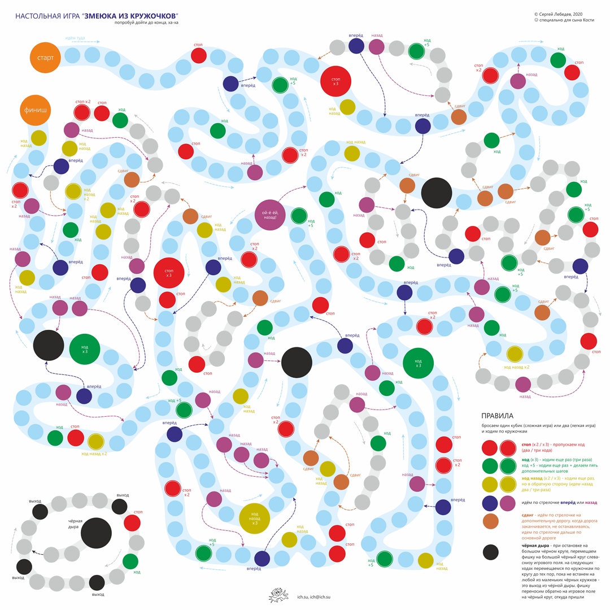
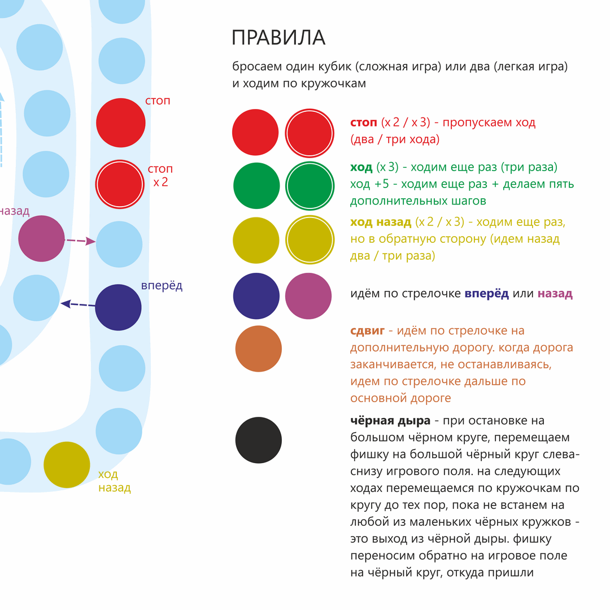
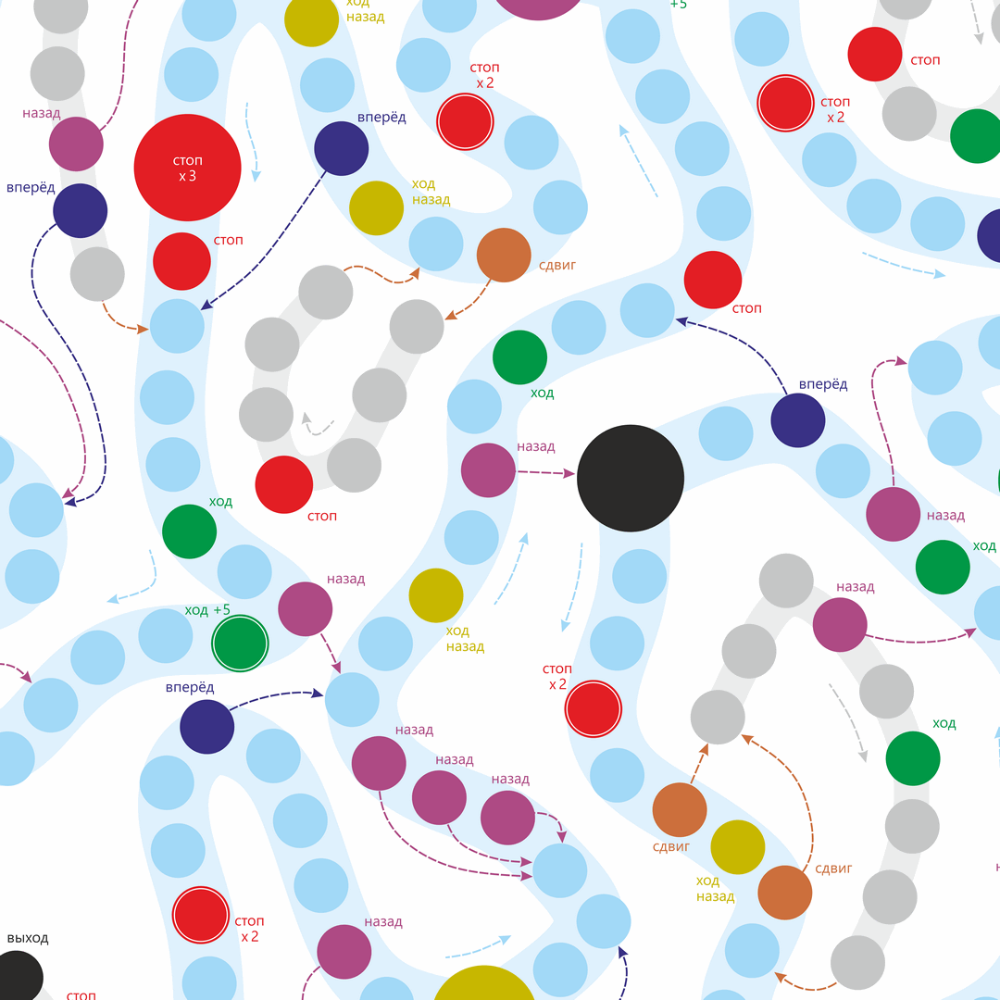
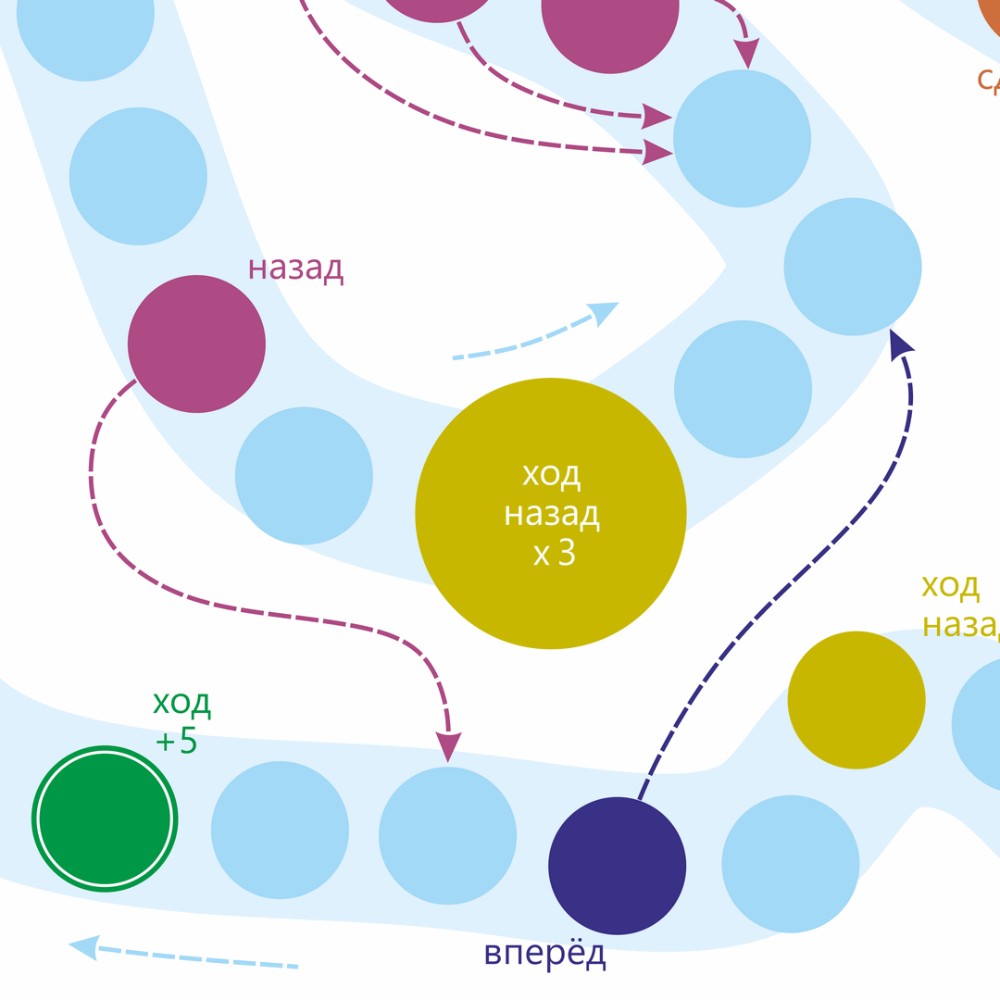

## Настольная игра "Змеюка из кружочков"

* **Год:** 2020
* **Среда разработки:** CorelDRAW
* **Статус:** Архив

Настольная игра с фишками и игральными кубиками. Лучше играть с двумя кубиками, поскольку с одним прохождение может занимать значительное время. Правила смотри на самой игре и скриншотах. 
Правила можно расширять. Например, мы, при перемещении фишки, если она попала на поле, где уже стоит фишка соперника, ставим нашу сверху (на “голову”) чужой фишки. И когда соперник кидает кубики и ходит, то заодно тащит и нас с собой. Потом, при нашем ходе, мы спрыгиваем. Это прикольно, учитывая, что соперник может идти назад или в чёрную дыру.

В [релизах](./../../releases) два файла:

1. png-файл с разрешением 2160 на 2160 пикселей, палитра 8 бит – это ознакомительная версия
2. png-файл с разрешением 14173 на 14173 пикселя, глубина цвета 24 бита - необходимо распечатать в цвете в размере от 600 мм на сторону. 

Отлично выглядит при распечатке на пластике.

Скриншоты:

* 
* 
* 
* 

страница проекта на гитхабе:
[github.com/ich-su/games](https://github.com/ich-su/games)

страница на ich.su:
[ich-su/boardgame](https://ich.su/boardgame)
